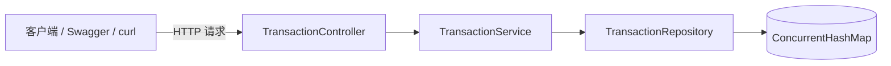

# Transaction Service

一个使用 Java 17、Spring Boot 3.5.7 和 Maven 实现的最小交易服务。

## 功能

- 创建交易
- 查询交易
- 确认交易
- 取消交易
- 请求参数校验
- 统一错误响应
- Swagger/OpenAPI 文档
- 内存数据存储
- 自动化测试

## 运行环境

- Java 17
- Spring Boot 3.5.7
- Maven Wrapper
## 运行测试

```bash
./mvnw test
```

## 启动服务

```bash
./mvnw spring-boot:run
```

服务默认运行在：

```text
http://localhost:8080
```

## API 文档

启动服务后访问：

- Swagger UI：http://localhost:8080/swagger-ui/index.html
- OpenAPI JSON：http://localhost:8080/v3/api-docs
## API 列表

| 方法 | 路径 | 说明 |
|---|---|---|
| POST | `/api/transactions` | 创建交易 |
| GET | `/api/transactions/{id}` | 查询交易 |
| POST | `/api/transactions/{id}/confirm` | 确认交易 |
| POST | `/api/transactions/{id}/cancel` | 取消交易 |

## 创建交易示例

请求：

```http
POST /api/transactions
Content-Type: application/json
```

```json
{
  "amount": 100.50,
  "description": "购买商品"
}
```

成功响应：

```json
{
  "id": "fa19a94f-6056-40eb-b3df-b91ca30c7127",
  "amount": 100.50,
  "description": "购买商品",
  "status": "PENDING",
  "createdAt": "2026-11-11T19:14:08"
}
```

## 架构图



## 错误响应

所有业务错误和参数校验错误使用统一结构：

```json
{
  "timestamp": "2026-11-11T19:29:53",
  "status": 400,
  "code": "VALIDATION_ERROR",
  "message": "请求参数校验失败",
  "errors": {
    "amount": "金额必须大于等于0.01",
    "description": "交易描述不能为空"
  }
}
```

### 错误代码

| HTTP 状态码 | 错误代码 | 说明 |
|---|---|---|
| 400 | `VALIDATION_ERROR` | 请求参数校验失败 |
| 404 | `TRANSACTION_NOT_FOUND` | 交易不存在 |
| 409 | `INVALID_TRANSACTION_STATE` | 当前交易状态不允许执行该操作 |