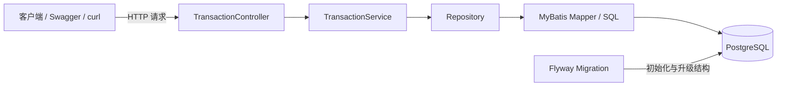

# Transaction Service

一个使用 Java 17、Spring Boot、MyBatis 和 PostgreSQL 实现的最小交易服务。

## 功能

- 创建交易
- 查询交易
- 确认交易
- 取消交易
- 请求参数校验
- 统一错误响应
- Swagger/OpenAPI 文档
- PostgreSQL 数据持久化
- Flyway 数据库迁移
- 唯一交易号和唯一幂等键
- 支付通道、交易尝试记录和审计日志
- 自动化测试

## 运行环境

- Java 17
- Spring Boot 3.5.7
- Maven Wrapper
- MyBatis
- PostgreSQL 17
- Flyway
- Docker Compose

## 启动 PostgreSQL

```bash
docker compose up -d
```

检查数据库状态：

```bash
docker compose ps
```

状态显示 `healthy` 后即可启动应用。停止数据库使用：

```bash
docker compose down
```

默认使用 Docker volume 保存数据，普通的 `docker compose down` 不会删除数据库内容。

## 运行测试

先确保 PostgreSQL 容器处于健康状态，然后运行：

```bash
./mvnw test
```

## 启动服务

```bash
./mvnw spring-boot:run
```

应用启动时，Flyway 会自动校验并执行尚未应用的数据库迁移。

服务默认运行在：

```text
http://localhost:8080
```

## API 文档

启动服务后访问：

- Swagger UI：http://localhost:8080/swagger-ui/index.html
- OpenAPI JSON：http://localhost:8080/v3/api-docs

## API 列表

| 方法 | 路径 | 说明 |
|---|---|---|
| POST | `/api/transactions` | 创建交易 |
| GET | `/api/transactions/{id}` | 查询交易 |
| POST | `/api/transactions/{id}/confirm` | 确认交易 |
| POST | `/api/transactions/{id}/cancel` | 取消交易 |

## 创建交易示例

请求：

```http
POST /api/transactions
Content-Type: application/json
```

```json
{
  "amount": 100.50,
  "description": "购买商品",
  "idempotencyKey": "order-20261112-0001",
  "currency": "CNY",
  "channelCode": "DEMO"
}
```

成功响应：

```json
{
  "id": "TXN-a5a9d058-0132-45e1-811b-7535e5b1eb7f",
  "amount": 100.5000,
  "description": "购买商品",
  "status": "PENDING",
  "createdAt": "2026-11-12T07:44:00Z",
  "idempotencyKey": "order-20261112-0001",
  "channelId": 1,
  "currency": "CNY",
  "updatedAt": "2026-11-12T07:44:00Z"
}
```

## 架构图



数据库包含四张业务表：

- `payment_transaction`：交易主表；
- `payment_channel`：支付通道；
- `transaction_attempt`：交易尝试历史；
- `audit_log`：状态变化审计记录。

## 错误响应

所有业务错误和参数校验错误使用统一结构：

```json
{
  "timestamp": "2026-11-11T19:29:53",
  "status": 400,
  "code": "VALIDATION_ERROR",
  "message": "请求参数校验失败",
  "errors": {
    "amount": "金额必须大于等于0.01",
    "description": "交易描述不能为空"
  }
}
```

### 错误代码

| HTTP 状态码 | 错误代码 | 说明 |
|---|---|---|
| 400 | `VALIDATION_ERROR` | 请求参数校验失败 |
| 404 | `TRANSACTION_NOT_FOUND` | 交易不存在 |
| 404 | `CHANNEL_NOT_AVAILABLE` | 支付通道不存在或已停用 |
| 409 | `INVALID_TRANSACTION_STATE` | 当前交易状态不允许执行该操作 |
| 409 | `DUPLICATE_IDEMPOTENCY_KEY` | 幂等键已经使用，拒绝重复创建 |

## 数据库文档

- [数据模型说明](docs/DATA_MODEL.md)
- [SQL 索引优化记录](docs/SQL_OPTIMIZATION.md)
