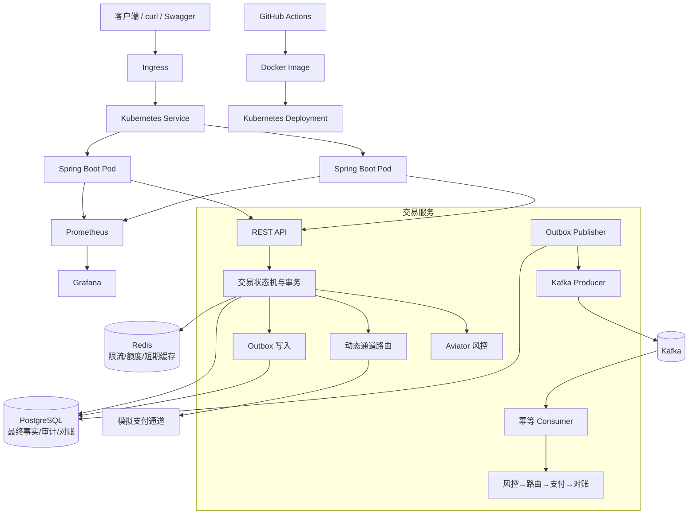
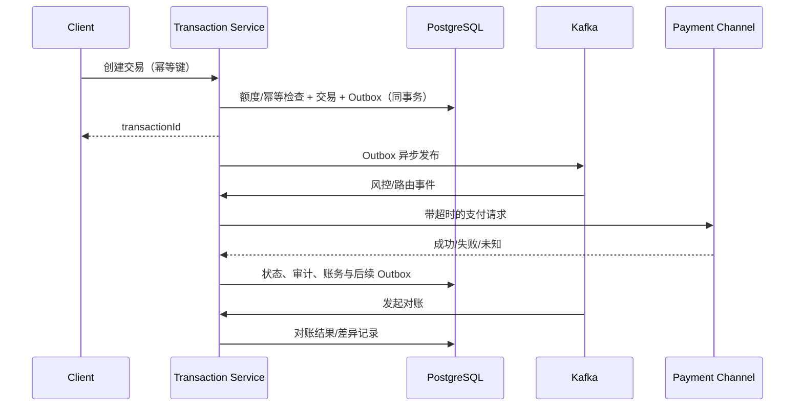

# Transaction Service 架构

## 总体架构

## 正确性主线

1. PostgreSQL 保存交易、状态版本、Outbox、审计和对账结果，是最终事实源。
2. `@Transactional` 保证业务变化与 Outbox 事件同事务提交；乐观锁阻止并发重复更新。
3. Kafka 使用交易号作为分区键保持单笔交易范围内顺序；消费者用 `processed_event` 去重。
4. Redis 只做加速和前置保护，故障时降级到数据库逻辑，不能替代账本。
5. readiness 控制流量准入，滚动发布和回滚控制发布风险，指标用于定位而非仅展示。

## 关键链路

