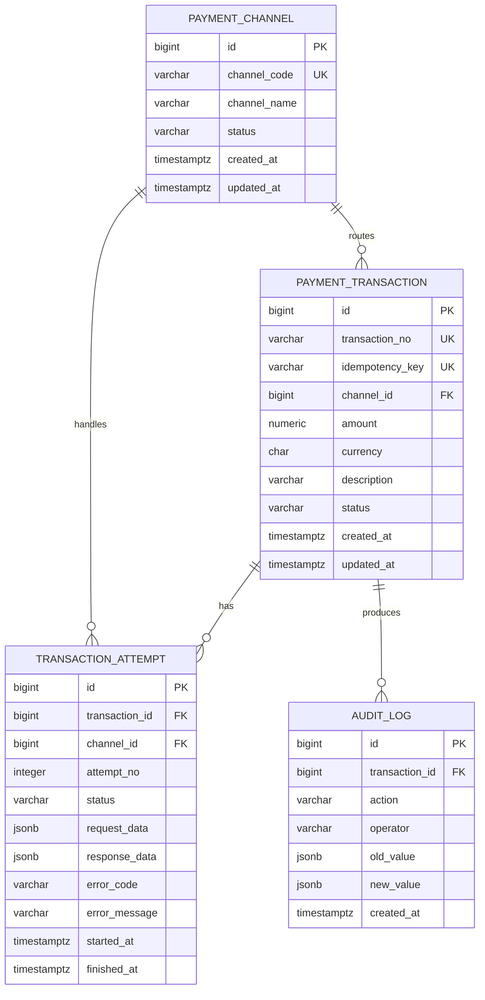

# 交易服务数据模型说明

## 1. 设计目标

本数据模型用于支持最小交易服务的持久化需求，包括：

- 保存交易主数据；
- 使用唯一交易号对外标识交易；
- 使用唯一幂等键阻止重复创建；
- 管理支付通道；
- 保存每次通道操作尝试；
- 保存不可随意修改的审计记录；
- 支持常用查询和按时间倒序查询。

数据库使用 PostgreSQL，结构由 Flyway 迁移文件自动创建和升级。

## 2. 实体关系



## 3. 表设计

### 3.1 `payment_channel`

支付通道基础信息表。

| 字段 | 类型 | 约束 | 说明 |
|---|---|---|---|
| `id` | `BIGSERIAL` | 主键 | 数据库内部通道 ID |
| `channel_code` | `VARCHAR(50)` | 非空、唯一 | 稳定的业务编码，例如 `DEMO` |
| `channel_name` | `VARCHAR(100)` | 非空 | 通道显示名称 |
| `status` | `VARCHAR(20)` | 非空、CHECK | `ACTIVE` 或 `INACTIVE` |
| `created_at` | `TIMESTAMPTZ` | 非空 | 创建时间 |
| `updated_at` | `TIMESTAMPTZ` | 非空 | 更新时间 |

`channel_code` 的唯一约束会自动创建唯一 B-tree 索引，支持按编码快速查询。

### 3.2 `payment_transaction`

交易主表，每笔业务交易保存一行。

| 字段 | 类型 | 约束 | 说明 |
|---|---|---|---|
| `id` | `BIGSERIAL` | 主键 | 数据库内部主键，不作为对外交易号 |
| `transaction_no` | `VARCHAR(64)` | 非空、唯一 | 对外唯一交易号 |
| `idempotency_key` | `VARCHAR(100)` | 非空、唯一 | 客户端请求幂等键 |
| `channel_id` | `BIGINT` | 外键 | 关联 `payment_channel.id` |
| `amount` | `NUMERIC(19,4)` | 非空、正数检查 | 交易金额 |
| `currency` | `CHAR(3)` | 非空 | 三位币种代码，例如 `CNY` |
| `description` | `VARCHAR(200)` | 非空 | 交易描述 |
| `status` | `VARCHAR(20)` | 非空、CHECK | `PENDING`、`CONFIRMED` 或 `CANCELLED` |
| `created_at` | `TIMESTAMPTZ` | 非空 | 创建时间 |
| `updated_at` | `TIMESTAMPTZ` | 非空 | 最后更新时间 |

`transaction_no` 与数据库内部主键分离，避免将连续主键直接暴露给外部调用方。

`idempotency_key` 由数据库唯一约束提供最终并发保障。即使两个相同请求同时到达，也只有一个事务能够成功插入。

### 3.3 `transaction_attempt`

记录一笔交易的每次通道操作尝试。一笔交易可以有多条尝试记录。

| 字段 | 类型 | 约束 | 说明 |
|---|---|---|---|
| `id` | `BIGSERIAL` | 主键 | 尝试记录 ID |
| `transaction_id` | `BIGINT` | 非空、外键 | 关联交易内部 ID |
| `channel_id` | `BIGINT` | 非空、外键 | 本次使用的通道 |
| `attempt_no` | `INTEGER` | 非空、正数检查 | 该交易的第几次尝试 |
| `status` | `VARCHAR(20)` | 非空、CHECK | `PROCESSING`、`SUCCEEDED` 或 `FAILED` |
| `request_data` | `JSONB` | 可空 | 通道请求摘要 |
| `response_data` | `JSONB` | 可空 | 通道响应摘要 |
| `error_code` | `VARCHAR(50)` | 可空 | 失败错误码 |
| `error_message` | `VARCHAR(500)` | 可空 | 失败说明 |
| `started_at` | `TIMESTAMPTZ` | 非空 | 尝试开始时间 |
| `finished_at` | `TIMESTAMPTZ` | 可空 | 尝试结束时间 |

联合唯一约束 `(transaction_id, attempt_no)` 防止同一交易出现重复的尝试序号。

`JSONB` 适合保存不同通道结构不完全一致的请求和响应摘要，但敏感信息不应直接写入。

### 3.4 `audit_log`

记录交易状态变化等关键操作。审计数据采用只追加设计，业务代码不提供更新和删除方法。

| 字段 | 类型 | 约束 | 说明 |
|---|---|---|---|
| `id` | `BIGSERIAL` | 主键 | 审计记录 ID |
| `transaction_id` | `BIGINT` | 外键、可空 | 关联交易；可空以支持系统级事件 |
| `action` | `VARCHAR(50)` | 非空 | 操作类型 |
| `operator` | `VARCHAR(100)` | 非空 | 操作者或服务名 |
| `old_value` | `JSONB` | 可空 | 修改前快照 |
| `new_value` | `JSONB` | 可空 | 修改后快照 |
| `created_at` | `TIMESTAMPTZ` | 非空 | 操作发生时间 |

当前操作者使用 `SYSTEM`，后续接入认证后可以保存用户 ID 或服务身份。

## 4. 索引设计

| 索引或约束 | 字段 | 主要用途 |
|---|---|---|
| `uk_payment_channel_code` | `channel_code` | 按唯一通道编码查询 |
| `uk_payment_transaction_no` | `transaction_no` | 按对外交易号查询 |
| `uk_payment_transaction_idempotency_key` | `idempotency_key` | 拒绝重复请求 |
| `idx_payment_transaction_status_created_at` | `status, created_at DESC` | 查询某状态的最近交易 |
| `idx_payment_transaction_channel_created_at` | `channel_id, created_at DESC` | 查询某通道的最近交易 |
| `idx_payment_transaction_currency_created_at` | `currency, created_at DESC` | 查询某币种的最近交易 |
| `uk_transaction_attempt_number` | `transaction_id, attempt_no` | 保证尝试序号唯一 |
| `idx_transaction_attempt_transaction_started_at` | `transaction_id, started_at DESC` | 查询交易尝试历史 |
| `idx_transaction_attempt_channel_status` | `channel_id, status` | 查询通道特定状态的尝试 |
| `idx_audit_log_transaction_created_at` | `transaction_id, created_at DESC` | 查询交易审计历史 |
| `idx_audit_log_action_created_at` | `action, created_at DESC` | 按操作类型查询审计记录 |

联合索引遵循“等值过滤列在前、排序或范围列在后”的基本设计。例如：

```sql
WHERE currency = 'USD'
ORDER BY created_at DESC
LIMIT 20
```

对应 `(currency, created_at DESC)`，既支持币种过滤，也支持结果顺序。

## 5. 金额字段设计

交易金额使用：

```sql
NUMERIC(19, 4)
```

Java 使用：

```java
BigDecimal
```

不使用 `FLOAT`、`DOUBLE PRECISION` 或 Java `double`，因为二进制浮点无法精确表示部分十进制金额。

`NUMERIC(19,4)` 最多保存 19 位有效数字，其中 4 位为小数。实际系统还应根据支持的币种明确舍入规则和最小货币单位。

## 6. 时间字段设计

数据库时间使用：

```sql
TIMESTAMPTZ
```

Java 使用：

```java
OffsetDateTime
```

`TIMESTAMPTZ` 表示明确的时间点，PostgreSQL 内部按时间点保存，并根据连接时区显示。API 返回的 `Z` 表示 UTC，与北京时间 `+08:00` 可以表示同一时刻。

## 7. 一致性与事务

确认或取消交易时，以下操作放在同一个 Spring `@Transactional` 事务中：

1. 更新交易状态；
2. 写入交易尝试记录；
3. 写入审计日志。

任意一步失败，整个事务回滚，避免出现交易状态已经变化但尝试记录或审计记录缺失的情况。

## 8. 迁移管理

数据库结构和初始数据由 Flyway 管理：

| 版本 | 内容 |
|---|---|
| V1 | 创建通道表 |
| V2 | 创建交易表和基础索引 |
| V3 | 创建交易尝试表 |
| V4 | 创建审计日志表 |
| V5 | 插入默认演示通道 |
| V6 | 添加币种与创建时间联合索引 |

已经成功执行的迁移文件不应直接修改。后续结构变化应创建更高版本的新迁移文件。
