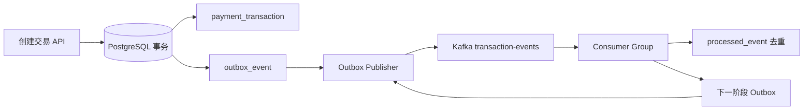

# Kafka 可靠消息设计

## 事件链路



业务事件依次为：

```text
TRANSACTION_CREATED
→ RISK_ASSESSMENT_COMPLETED
→ CHANNEL_ROUTED
→ PAYMENT_SUCCEEDED
→ RECONCILIATION_REQUESTED
```

## 生产端如何避免丢消息

- 交易数据与 Outbox 事件在同一个 PostgreSQL 事务中提交，避免数据库成功但 Kafka 消息未发送的双写问题。
- Publisher 使用 `FOR UPDATE SKIP LOCKED` 原子领取事件，多实例不会同时领取同一事件。
- Producer 配置 `acks=all`、重试和幂等 Producer，并等待发送 Future 完成后才将 Outbox 标记为 `PUBLISHED`。
- 发送失败时恢复为 `PENDING`，保存 `last_error`，设置下一次重试时间。
- `PROCESSING` 锁超过3分钟可被重新领取；锁超时大于 Producer 的2分钟发送超时。

## Broker如何保障可靠性

- `acks=all` 要求所有同步副本确认后才算成功。
- 生产环境应使用多个 Broker、`replication.factor >= 3`、合理的 `min.insync.replicas`，并禁止不干净 Leader 选举。
- 当前本地单 Broker、单副本配置只适合学习，Broker宕机会暂时不可用，不能代表生产高可用。

## 消费者如何处理重复

- Kafka、Producer重试和Outbox崩溃恢复都可能造成重复投递，因此系统采用至少一次语义。
- Consumer 在业务处理前插入 `processed_event`。
- `(event_id, consumer_group)` 唯一约束配合 `ON CONFLICT DO NOTHING` 判断是否首次处理。
- 去重记录、当前业务处理和下一阶段 Outbox 写入位于同一个数据库事务；异常时一起回滚。

## 如何保证业务范围内顺序

- 使用 `transactionId` 作为 Kafka Key。
- 相同交易号始终进入同一个 Partition，Partition 内按 Offset 有序。
- 不追求整个 Topic 的全局顺序，不同交易可由不同 Partition 并行处理。
- Retry Topic 会改变完成顺序，因此下游仍需状态机、幂等和版本检查，不能只依赖消息到达顺序。

## Retry Topic 与死信队列

- `@RetryableTopic` 最多尝试4次，退避时间依次增加。
- 短暂故障进入 Retry Topic，毒消息最终进入 DLT。
- DLT 需要告警、人工排查、修复后重放，不能当作永久垃圾桶。

## Consumer Lag

- Kafka CLI 使用 `kafka-consumer-groups.sh --describe` 查看各分区 Lag。
- Actuator 指标：`kafka.consumer.fetch.manager.records.lag.max`。
- 生产环境可由 Prometheus采集，并按持续时间和增长速度告警。

## Outbox解决了什么，又带来了什么

解决：

- 本地业务写库与“准备发送消息”的原子性；
- Kafka临时不可用时事件不丢失；
- 发布失败后的可追踪重试。

代价：

- 增加 Outbox 表、轮询器、状态恢复和数据清理；
- 数据库到 Kafka 存在秒级延迟；
- Kafka发送成功但状态更新前崩溃会重复发送；
- 必须监控积压、失败次数、陈旧锁和表容量；
- Outbox只保证至少一次发布，消费者幂等仍不可省略。

## 已完成故障实验

| 场景 | 结果 |
|---|---|
| Kafka不可用 | Outbox恢复为`PENDING`并记录错误，Broker恢复后自动补发 |
| 发送成功但状态未更新 | 陈旧锁被重新领取，消息重复发送，Consumer去重后业务仅执行一次 |
| 重复投递 | `processed_event`唯一约束保证每个消费者组只处理一次 |
| 消费者处理中崩溃 | 数据库事务回滚，重试仍可重新处理 |
| 毒消息 | 多次失败后进入DLT |
| 消息积压 | CLI和Actuator均能观察Lag上升和归零 |
| 重试乱序 | Retry Topic可能让后续事件先完成，业务需状态机保护 |

