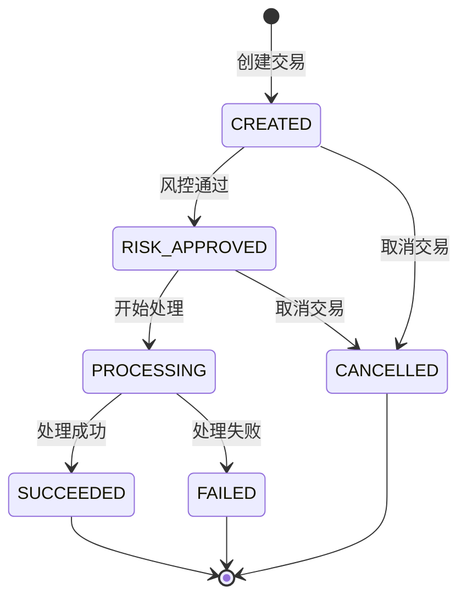

# 交易状态机设计

## 状态流转图



## 状态说明

| 状态 | 含义 |
|---|---|
| `CREATED` | 交易已经创建，尚未通过风控 |
| `RISK_APPROVED` | 交易已经通过风控 |
| `PROCESSING` | 交易正在通过支付通道处理 |
| `SUCCEEDED` | 交易处理成功，终态 |
| `FAILED` | 交易处理失败，终态 |
| `CANCELLED` | 交易已取消，终态 |

## 合法状态转换

| 当前状态 | 操作 | 目标状态 |
|---|---|---|
| `CREATED` | 风控通过 | `RISK_APPROVED` |
| `CREATED` | 取消 | `CANCELLED` |
| `RISK_APPROVED` | 开始处理 | `PROCESSING` |
| `RISK_APPROVED` | 取消 | `CANCELLED` |
| `PROCESSING` | 处理成功 | `SUCCEEDED` |
| `PROCESSING` | 处理失败 | `FAILED` |

## 并发控制

`payment_transaction.version` 用作乐观锁版本号。

状态更新 SQL 会同时检查交易号和当前版本：

```sql
UPDATE payment_transaction
SET status = :newStatus,
    version = version + 1,
    updated_at = CURRENT_TIMESTAMP
WHERE transaction_no = :transactionNo
  AND version = :currentVersion;
```

如果影响行数为 `0`，说明其他请求已经修改该交易，系统抛出
`OptimisticLockConflictException`，避免重复确认和旧数据覆盖。

## 事务一致性

一次状态转换在同一个 Spring 事务中完成：

1. 更新交易状态和乐观锁版本；
2. 写入交易尝试记录；
3. 写入审计日志；
4. 写入 Outbox 事件；
5. 统一提交。

任何一步抛出运行时异常，全部数据库操作一起回滚。

## Outbox 事件

状态变化时写入对应事件：

| 目标状态 | 事件类型 |
|---|---|
| `RISK_APPROVED` | `TRANSACTION_RISK_APPROVED` |
| `PROCESSING` | `TRANSACTION_PROCESSING` |
| `SUCCEEDED` | `TRANSACTION_SUCCEEDED` |
| `FAILED` | `TRANSACTION_FAILED` |
| `CANCELLED` | `TRANSACTION_CANCELLED` |

Outbox 初始状态为 `PENDING`，后续由事件发布程序读取并发布。